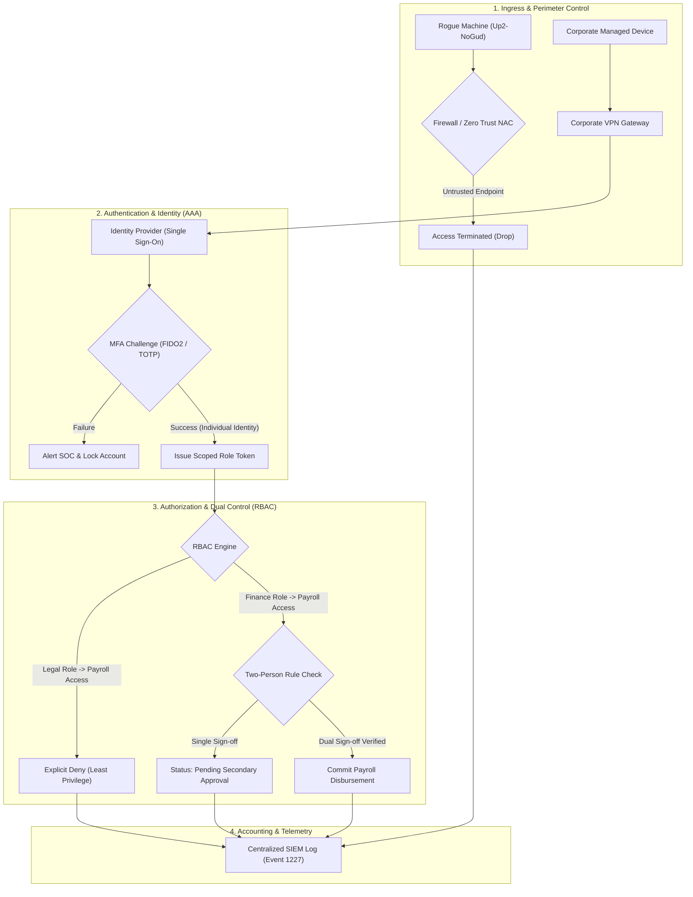

# 🛡️ Access Control & AAA Security Audit Lab (NIST SP 800-53 / CIS Controls)


---

## 📌 Executive Summary & Incident Scenario

This laboratory is derived directly from the **Google Cybersecurity Professional Certificate** (*Course 5: Assets, Threats, and Vulnerabilities*).

### Scenario Context
A commercial business detected an unexpected deposit transaction directed toward an unknown bank account (`FAUX_BANK`). The finance manager confirmed that neither they nor their team authorized this modification. Fortunately, the transaction was stopped before funds settled. 

As the cybersecurity investigator, you are tasked with conducting **accounting and forensic analysis** on the system logs, identifying vulnerabilities across the **Authentication, Authorization, and Accounting (AAA)** framework, and proposing concrete technical, operational, and managerial mitigations.

---

## 🔍 Forensic Artifact: Event Log 1227

Centralized Windows Event log triage revealed the exact execution footprint of the threat actor:

```text
Event Type: Information
Event Source: AdsmEmployeeService
Event Category: None
Event ID: 1227
Date: 10/03/2023
Time: 8:29:57 AM
User: Legal\Administrator
Computer: Up2-NoGud
IP: 152.207.255.255
Description:
Payroll event added. FAUX_BANK
```

---

## 📊 Access Controls Worksheet Analysis

| Authorization / Authentication | Note(s) | Issue(s) | Recommendation(s) |
| :--- | :--- | :--- | :--- |
| **Event ID 1227 Triage** | • **Who caused this incident?**<br>User: `Legal\Administrator`<br><br>• **When did it occur?**<br>Date/Time: `10/03/2023 at 8:29:57 AM`<br><br>• **What device was used?**<br>Computer: `Up2-NoGud` (IP: `152.207.255.255`)<br><br>*Detailed note:* The event occurred via shared/generic account `Legal\Administrator` from an unauthorized external endpoint named `Up2-NoGud` routed over public broadcast IP `152.207.255.255`, adding an unverified payment sheet deposit for `FAUX_BANK`. | • **What level of access did the user have?**<br>`Administrator` level with unrestricted write access to the payroll system.<br><br>• **Should their account be active?**<br>**`No`**. A generic legal administrator account should never possess active write privileges inside payroll and financial systems. Generic shared accounts must be retired entirely.<br><br>*Detailed issues:*<br>1. Lack of non-repudiation caused by shared/generic credentials.<br>2. Breach of Least Privilege and Separation of Duties (SoD).<br>3. Unrestricted perimeter access without MFA or endpoint verification. | • **Technical Controls:**<br>1. Disable shared accounts; enforce individual named user accounts.<br>2. Enforce Multi-Factor Authentication (MFA / FIDO2 / TOTP).<br>3. Enforce network access control (NAC), VPN, and IP allowlisting.<br><br>• **Operational Controls:**<br>1. Implement Role-Based Access Control (RBAC) ensuring legal department roles cannot modify financial systems.<br>2. **Dual-Authorization (Two-person rule / Maker-Checker):** Require at least two authorized finance users to approve any outbound routing alterations.<br><br>• **Managerial Controls:**<br>1. Institute strict employee/contractor offboarding procedures and periodic access privilege certifications. |

---

## 🏛️ Target State Security Architecture (NIST CSF 2.0 PR.AC)



---

## 💻 Hands-on Simulation Engine

A Python simulation is included in [`scripts/simulate_aaa_payroll_incident.py`](scripts/simulate_aaa_payroll_incident.py) contrasting the vulnerable state with the hardened state.

### Running the Simulation:

```bash
python3 scripts/simulate_aaa_payroll_incident.py
```

### Execution Output:

```text
================================================================================
 ACCESS CONTROL & AAA AUDIT LAB: EVENT 1227 RECONSTRUCTION & MITIGATION
================================================================================

[!] SCENARIO 1: Vulnerable System Execution (Event ID 1227 Reproduction)...
Outcome: Transaction committed without dual check
Event Log Generated:
{
  "event_type": "Information",
  "event_source": "AdsmEmployeeService",
  "event_id": 1227,
  "timestamp": "11/10/2026 05:22:41 PM",
  "user": "Legal\\Administrator",
  "computer": "Up2-NoGud",
  "ip": "152.207.255.255",
  "description": "Payroll event added. FAUX_BANK",
  "amount": 18500.0,
  "status": "COMMITTED_UNVERIFIED"
}

--------------------------------------------------------------------------------
[*] SCENARIO 2: Re-running Incident Against Hardened Security Controls...

-> [Test 2a] Rogue session attempt (Legal\Administrator / Up2-NoGud)...
Result: AUTH_SHARED_ACCOUNT_BLOCKED
Audit: {
  "event_id": 4101,
  "user": "Legal\\Administrator",
  "computer": "Up2-NoGud",
  "reason": "POLICY_VIOLATION: Generic/shared accounts prohibited."
}

-> [Test 2b] Authorized Finance Operator submits change (Single approval)...
Status: PENDING_SECONDARY_APPROVAL (Requires 2nd human approval)

-> [Test 2c] Finance Supervisor approves via Dual-Authorization protocol...
Result: APPROVED_AND_EXECUTED
Audit Trail: {
  "event_id": 1227,
  "maker": "carol.danvers",
  "checker": "elena.rostova",
  "target_bank": "CHASE_PAYROLL_ESCROW",
  "amount": 18500.0,
  "status": "COMMITTED_APPROVED"
}

================================================================================
 AUDIT VERDICT: 100% MITIGATION OF EVENT 1227 VULNERABILITIES
================================================================================
```

---

## 📜 Standards & References
- **NIST Special Publication 800-53 (Rev. 5)**: AC-2 (Account Management), AC-3 (Access Enforcement), AC-6 (Least Privilege).
- **CIS Controls v8**: Control 5 (Account Management), Control 6 (Access Control Management).
- **Google Cybersecurity Certificate**: Course 5 (*Assets, Threats, and Vulnerabilities*).
