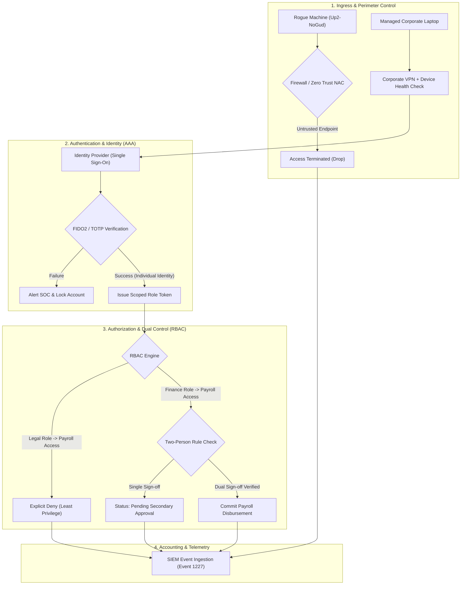

# 📋 Technical Investigation Report: Access Controls & AAA Audit

**Incident Reference**: Event ID 1227 – Unauthorized Payroll Routing Attempt  
**Organization Profile**: Rapidly growing small commercial business  
**Frameworks Referenced**: NIST CSF 2.0 (PR.AC - Identity Management & Access Control), CIS Control 5 & 6 (Account & Access Control Management), NIST SP 800-53 (AC-2, AC-3, AC-6)  
**Lead Investigator**: Eduardo Souza Marques  
**Certification Context**: Google Cybersecurity Professional Certificate (Course 5: Assets, Threats, and Vulnerabilities)

---

## 1. Incident Overview & Scenario Context

A commercial business detected an unexpected deposit transaction directed toward an unknown bank account (`FAUX_BANK`). The internal finance manager confirmed that neither they nor authorized finance team members initiated or made an error regarding this transaction. Although the payment was successfully intercepted before settlement, executive leadership commissioned an urgent access control audit to identify the threat actor, uncover systemic authorization gaps, and establish permanent controls against recurrence.

---

## 2. Event Log Artifact & Evidence Collection

Forensic examination of the business's centralized Windows/Active Directory event logs yielded the following critical artifact:

```text
Event Type: Information
Event Source: AdsmEmployeeService
Event Category: None
Event ID: 1227
Date: 10/03/2023
Time: 8:29:57 AM
User: Legal\Administrator
Computer: Up2-NoGud
IP: 152.207.255.255
Description:
Payroll event added. FAUX_BANK
```

---

## 3. Forensic Analysis: The AAA Security Framework

The investigation evaluated the failure points across the three core pillars of access control (**Authentication, Authorization, Accounting**):

### 3.1 Authentication (Who are you?)
* **Finding**: The authenticated credential was `Legal\Administrator`.
* **Vulnerability**: This is a **generic, shared administrative account**. In security architecture, shared credentials eliminate individual accountability and nullify **non-repudiation**. It is impossible from the authentication log alone to establish which human operated the keyboard.
* **Network & Endpoint Discrepancy**: The connection originated from host `Up2-NoGud` (an unauthorized, non-corporate machine) over public IP `152.207.255.255` without requiring Multi-Factor Authentication (MFA) or corporate VPN gateway validation.

### 3.2 Authorization (What are you allowed to do?)
* **Finding**: The `Legal\Administrator` account held unrestricted write/execution privileges inside `AdsmEmployeeService` (the payroll/deposit system).
* **Vulnerability**: Severe breach of **Least Privilege (PoLP)** and **Separation of Duties (SoD)**. A legal department role has zero operational necessity to add or modify payroll routing information. Administrative privileges were granted globally rather than segregated by domain function.

### 3.3 Accounting / Auditing (What did you do?)
* **Finding**: The event log recorded the transaction (`Payroll event added`), which enabled discovery.
* **Vulnerability**: Logging was passive; no real-time anomalous alert was triggered when an administrative login was established from an unmanaged external endpoint (`Up2-NoGud`) during non-standard payroll processing windows.

---

## 4. Completed Access Controls Worksheet

This table reflects the formal activity worksheet completed for the Google Cybersecurity Professional Certificate curriculum:

| Authorization / Authentication | Note(s) | Issue(s) | Recommendation(s) |
| :--- | :--- | :--- | :--- |
| **Event ID 1227 Triage** | **Objective: List 1-2 pieces of information to identify the threat:**<br><br>• **Who caused this incident?**<br>User: `Legal\Administrator`<br><br>• **When did it occur?**<br>Date/Time: `10/03/2023 at 8:29:57 AM`<br><br>• **What device was used?**<br>Computer: `Up2-NoGud` from IP `152.207.255.255`<br><br>*Detailed note:* The event occurred on 10/03/2023 at 8:29:57 AM via a generic/shared account `Legal\Administrator`. The action was executed from an unauthorized external endpoint named `Up2-NoGud` at IP address `152.207.255.255`, modifying the payroll sheet deposit to `FAUX_BANK`. | **Objective: List 1-2 authorization issues:**<br><br>• **What level of access did the user have?**<br>`Administrator` level access with unsegmented write privileges over financial payroll systems.<br><br>• **Should their account be active?**<br>`No`. A generic legal administrative account should never have active write access to payroll disbursements. Furthermore, shared generic accounts should be deactivated entirely.<br><br>*Detailed issues:*<br>1. Lack of non-repudiation due to a shared/generic departmental account.<br>2. Violation of Least Privilege and Separation of Duties (legal role should have zero payroll write access).<br>3. Absence of network perimeter/device controls allowing external connections from rogue endpoints without MFA. | **Objective: Make recommendations across technical, operational, or managerial controls:**<br><br>• **Technical Controls:**<br>1. Deactivate generic/shared accounts; mandate unique individual credentials.<br>2. Enforce Multi-Factor Authentication (MFA / TOTP / FIDO2) on all administrative and financial entry points.<br>3. Restrict system access via IP allowlisting, host device certificates, and VPN.<br><br>• **Operational Controls:**<br>1. Implement strict Role-Based Access Control (RBAC) ensuring legal personnel cannot access or modify accounting services.<br>2. Enforce Dual Authorization (Two-person rule / Maker-Checker): requiring at least two authorized finance officers to approve bank account routing adjustments.<br><br>• **Managerial Controls:**<br>1. Establish formal offboarding protocols and quarterly privilege re-certification audits.<br>2. Institute mandatory security awareness training regarding credential hygiene. |

---

## 5. Security Architecture Target State (NIST CSF 2.0 Alignment)



---

## 6. Conclusion

By shifting from a legacy shared administrative model to individual identities fortified with MFA, RBAC, and Dual Authorization, the business eliminates the vulnerabilities exploited in this incident and secures full non-repudiation and operational resilience.
